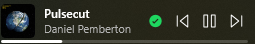

# SpotDock

A lightweight Spotify widget for your Windows taskbar.
SpotDock displays whatever is playing (or paused) in **Spotify Desktop** (classic installer & Microsoft Store via Windows SMTC) or **Spotify Web / browser PWA** (`open.spotify.com` via the optional `SpotDock Bridge` extension). When no Spotify track is loaded or Spotify is closed, the widget stays hidden.



## Install

1. Download `SpotDock-Setup.exe` and run it. No administrator rights are
   needed; it installs into the user profile as a standalone native executable (`SpotDock.exe`).
2. **Optional (for Spotify Web / PWA):** install the `SpotDock Bridge` browser extension:
   - open `edge://extensions` (`chrome://extensions` in Chrome);
   - turn on **Developer mode**;
   - click **Load unpacked** and choose the `spotdock-bridge` folder inside the
     installation folder (the installer offers to open it).

## Highlights

- **Spotify-only:** ignores other Windows media players, YouTube, SoundCloud, and non-Spotify browser tabs.
- **Desktop & Web/PWA:** reads Spotify Desktop through Windows SMTC (with UI Automation favorites support) and Spotify Web (`open.spotify.com`) through the `SpotDock Bridge` extension.
- **Stay-visible paused state, hidden when idle:** keeps paused tracks visible for both Desktop and Web, and hides the widget when no track is loaded or Spotify is closed.
- **Click to reveal:** clicking the track title raises the Spotify Desktop window or focuses the Spotify Web tab.
- **Quick controls:** play/pause, previous/next, middle-click anywhere to skip next, seekable progress bar, and favorites (+/✓).
- **Taskbar integration:** anchors cleanly to the Windows 11 taskbar (including weather button content), smooth width changes, brightness presets, and auto-hides for fullscreen apps.
- Settings and error log live in `%APPDATA%\SpotDock\`.

Technical details and pitfalls are in [AGENTS.md](AGENTS.md). See also [Troubleshooting](docs/TROUBLESHOOTING.md) and [Privacy Policy](docs/PRIVACY.md).

## Building

Requires the .NET 11 SDK and Visual Studio C++ Build Tools on Windows:

```
build.cmd
```

Or invoke `dotnet publish` directly:

```
dotnet publish src/SpotDock/SpotDock.csproj -c Release -o artifacts/publish
```

Produces a standalone NativeAOT `SpotDock.exe` with no .NET runtime dependency (`build.cmd local` builds a framework-dependent binary into `artifacts/local` without C++ Build Tools).

## How it works

> Independent project, **not affiliated with, sponsored or endorsed by Spotify AB**.
> "Spotify" is a trademark of Spotify AB.

- **Spotify Desktop:** Track data comes from the **Windows media session API (SMTC)**
  filtered strictly to Spotify desktop sessions (classic Win32 and Microsoft Store).
  Saved/liked state is read and toggled through Spotify's accessibility tree via
  native COM UI Automation.
- **Spotify Web / PWA:** The optional **SpotDock Bridge** extension reads
  `navigator.mediaSession` and Spotify Web player controls/slider state on
  `https://open.spotify.com/*` and sends updates over loopback WebSocket
  (`127.0.0.1:45219`).
- **Taskbar integration:** Renders as a borderless layered Win32 window (`Direct2D`
  / `DirectWrite`) docked over the Windows 11 taskbar, adapting to centered or
  left-aligned taskbars, auto-hide, DPI changes, and hiding automatically when an
  app goes fullscreen or when no Spotify track is loaded.

## Usage

- **Position:** Automatic by default. Press and hold on the artwork or
  title/artist area and drag to position manually.
- **Reveal Spotify:** Click the title/artist area to focus the Spotify Desktop
  window or Spotify Web tab.
- **Controls:** Play/pause, previous/next, middle-click anywhere to skip to the
  next track, click/drag the progress bar to seek, scroll wheel to adjust system
  volume, and `+` / green check to save to favorites.
- **Settings menu:** Right-click the widget for Brightness presets (20%–100%),
  Show cover art, Progress bar, Start with Windows, Check for updates, and Quit.
- Settings and error log live in `%APPDATA%\SpotDock\`.

## Structure

```
SpotDock.sln
build.cmd
src/
  SpotDock/          NativeAOT Win32/Direct2D widget application
  spotdock-bridge/   MV3 browser extension for https://open.spotify.com/*
tests/
  SpotDock.Tests/    xUnit test suite
build/
  setup.iss          Inno Setup 6 installer script
docs/                Demo image, troubleshooting guide, and privacy policy
artifacts/           Build, test, and installer outputs (gitignored)
```

| File | Role |
|---|---|
| `src/SpotDock/WidgetWindow.cs` | Core Win32 widget window lifecycle, track refresh, marquee, and WndProc |
| `src/SpotDock/WidgetWindow.Layout.cs` | Taskbar positioning, anchoring, fullscreen detection, and responsive sizing |
| `src/SpotDock/WidgetWindow.Animations.cs` | Progress bar, scrubbing pill, hover/opacity animations, and render dispatch |
| `src/SpotDock/WidgetWindow.Input.cs` | Hit testing, mouse clicks, drag-to-position, and wheel volume |
| `src/SpotDock/WidgetWindow.Menu.cs` | Native Win32 context menu, autostart, and update prompts |
| `src/SpotDock/UiStrings.cs` | English UI strings for menus, idle state, and update prompts |
| `src/SpotDock/D2DRenderer.cs` | Direct2D/DirectWrite/WIC rendering and layered window presentation |
| `src/SpotDock/ScrubPillWindow.cs` | Floating Direct2D scrub timestamp pill |
| `src/SpotDock/UiThread.cs` | Win32 message loop and `SynchronizationContext` |
| `src/SpotDock/MediaHub.cs` | Shared source combining Spotify Desktop (SMTC) and Spotify Web (`BrowserBridge`) |
| `src/SpotDock/MediaArbitration.cs` | Pure source-selection and Spotify app-ID classification helpers |
| `src/SpotDock/MediaService.cs` | Windows SMTC reader filtered to Spotify Desktop sessions |
| `src/SpotDock/BrowserBridge.cs` | Loopback WebSocket server (`127.0.0.1:45219`) for `open.spotify.com` |
| `src/spotdock-bridge/` | MV3 extension (`SpotDock Bridge`) scoped to `https://open.spotify.com/*` |
| `src/SpotDock/SpotifyUiaService.cs` | Spotify Desktop accessibility (native COM `IUIAutomation`) |
| `src/SpotDock/SourceActivator.cs` | Focuses Spotify Desktop window or Spotify Web browser window |
| `src/SpotDock/Interop.cs` | Win32 (taskbar position, topmost, fullscreen detection, input) |
| `src/SpotDock/WidgetSettings.cs` | Position, opacity, and UI options stored as JSON |
| `tests/SpotDock.Tests/` | xUnit tests for arbitration, WebSocket bridge, settings, and release parsing |
